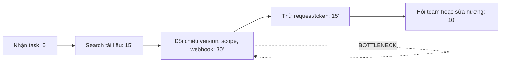
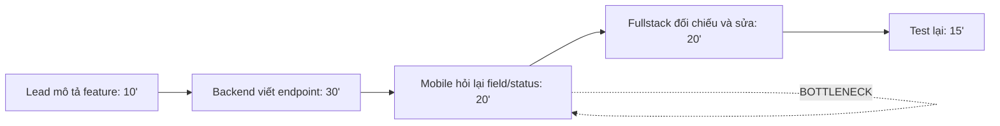
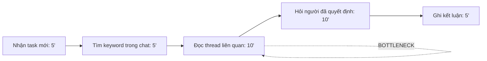

# Báo cáo cá nhân — Bảo Hoàng Thiên Phúc

> Case study được dựng từ bối cảnh làm fullstack web CRM/landing và vai trò trong nhóm xây hệ sinh thái chat nội bộ. Các số liệu thời gian là ước lượng dùng cho pilot; cần thay bằng số liệu thật nếu có.

## 1. Thông tin học viên

- Họ tên: Bảo Hoàng Thiên Phúc
- MSSV: 2A202603550
- Email trường (không bắt buộc):
- Tên nhóm: NhomCuaCat
- Vai trò: Fullstack developer
- Link repo nhóm: https://github.com/peaceminusone214/K5-L3A-DAY02-NhomCuaCat-DiscoveryProblemFraming

---

## 2. Scan problem (CP1)

Lăng kính: **Lặp lại** · **Tốn thời gian** · **Cần đọc, tổng hợp nhiều thông tin** · **Pain từ người khác**.

| # | Lăng kính | Job Story: Khi… tôi muốn… để… | Ai chịu ảnh hưởng? | Dấu hiệu thật |
|---:|---|---|---|---|
| 1 | Cần đọc, tổng hợp nhiều thông tin | Khi cần tích hợp một endpoint của Meta, tôi muốn tìm đúng tài liệu về quyền, request và webhook, để triển khai mà không phải thử sai quá nhiều lần | Fullstack, backend | Mỗi lần mất khoảng 60–90 phút; thường phải mở 5–8 trang và đọc lại từ đầu |
| 2 | Cần đọc, tổng hợp nhiều thông tin | Khi cần tích hợp Zalo vào luồng chat, tôi muốn biết tài liệu nào còn phù hợp với phiên bản hiện tại, để tránh dùng ví dụ cũ | Fullstack, mobile, backend | 2–3 lần trong một sprint; có lần mất gần 2 giờ vì endpoint và quyền không khớp |
| 3 | Cần đọc, tổng hợp nhiều thông tin | Khi cần kiểm tra TikTok Developer API, tôi muốn nối được tài liệu sản phẩm, OAuth và giới hạn request, để ước lượng đúng phần việc | Fullstack, backend | Khoảng 45–60 phút/lần; phải đọc từ 3 nhóm tài liệu khác nhau |
| 4 | Lặp lại | Khi bắt đầu một integration mới, tôi muốn có checklist các bước cần kiểm tra, để không quên redirect URI, scope hoặc webhook | Fullstack, backend | Mỗi integration dùng lại gần cùng checklist; hiện đang ghi rời rạc trong chat |
| 5 | Tốn thời gian | Khi gặp lỗi 401/403 lúc gọi API, tôi muốn biết lỗi nằm ở token, scope hay môi trường, để sửa đúng chỗ thay vì đổi code ngẫu nhiên | Backend, fullstack | 2–4 lần/tuần; mỗi lần mất khoảng 20–40 phút |
| 6 | Pain từ người khác | Khi mobile dev hỏi backend về format sự kiện chat, tôi muốn trả lời bằng một mô tả thống nhất, để hai bên không phải sửa payload nhiều lần | Mobile, backend, fullstack | Trong một feature thường có 3–5 lượt hỏi lại về field và trạng thái |
| 7 | Tốn thời gian | Khi quyết định kỹ thuật nằm trong nhiều thread chat, tôi muốn tìm lại được lý do và người quyết định, để không tranh luận lại từ đầu | Cả nhóm | Khoảng 3 lần/tuần; mỗi lần tìm 10–15 phút |
| 8 | Pain từ người khác | Khi một thành viên nghỉ hoặc chuyển task, tôi muốn người khác hiểu được ngữ cảnh integration đang làm, để công việc không bị đứng | Cả nhóm | Mỗi lần handoff mất 30–45 phút; thông tin thường nằm trong tin nhắn cá nhân |

**Nếu có dùng AI để gợi ý thêm:** Tôi giữ lại ý về checklist integration và việc tìm lại quyết định kỹ thuật vì chúng liên quan trực tiếp tới bối cảnh nhóm. Tôi bỏ ý “trợ lý AI quản lý toàn bộ hệ sinh thái” vì quá rộng, không có actor và quy trình cụ thể.

---

## 3. Top 3 Problem Cards + quy trình nháp (CP2)

### Bảng chọn top 3

| Rank | Problem | Vì sao chọn | Điều còn chưa chắc |
|---:|---|---|---|
| 1 | Tìm và xác nhận tài liệu API Meta/Zalo/TikTok | Pain lặp lại, actor rõ, thời gian đo được và ảnh hưởng trực tiếp tới tiến độ | Có thể giảm nhiều bằng checklist và kho link chuẩn hay thật sự cần AI? |
| 2 | Handoff ngữ cảnh giữa backend, mobile và fullstack | Liên quan trực tiếp tới việc build hệ sinh thái chat; dễ quan sát qua số lượt hỏi lại | Chất lượng handoff đo bằng thời gian hay số lỗi payload? |
| 3 | Tìm lại quyết định kỹ thuật trong chat nội bộ | Có liên quan tới giao tiếp nhóm và thường xuyên xảy ra | Phạm vi tìm kiếm dễ rộng; quyền truy cập lịch sử chat có thể là vấn đề |

### Problem Card #1

| Trường | Nội dung |
|---|---|
| Job Story | Khi cần tích hợp một API bên thứ ba cho hệ sinh thái chat, tôi muốn tìm đúng tài liệu và biết phần nào áp dụng cho project, để bắt đầu code mà không thử sai nhiều lần |
| Actor | Fullstack developer hoặc backend developer phụ trách integration |
| Thời điểm / bối cảnh | Khi nhận task tích hợp Meta, Zalo hoặc TikTok; thường ở đầu sprint |
| Quy trình hiện tại (3–7 bước) | 1. Nhận yêu cầu · 2. Search trang developer · 3. Mở nhiều phiên bản tài liệu · 4. Thử token/endpoint · 5. Hỏi backend hoặc team lead · 6. Ghi lại link |
| Bottleneck | Đối chiếu version, scope và webhook, khoảng 45–60 phút |
| Impact | Trễ việc integration, tăng số lần hỏi và dễ dùng nhầm endpoint hoặc scope |
| Success metric | Từ 60 phút xuống dưới 20 phút; giảm câu hỏi lặp lại từ 4 xuống tối đa 1 lần/task |
| Phương án không dùng AI | Catalogue tài liệu chính thức, checklist integration và quy ước ghi version/ngày kiểm tra |
| Giả thuyết về AI (nếu có) | Workflow tìm trong catalogue rồi tóm tắt điểm cần đọc, luôn kèm link nguồn |
| Cảm nhận nhanh | Workflow |

Quy trình nháp hiện tại:

### Problem Card #2

| Trường | Nội dung |
|---|---|
| Job Story | Khi backend và mobile cùng triển khai một sự kiện chat, tôi muốn mọi người hiểu cùng một payload và trạng thái, để giảm vòng sửa do giao tiếp không rõ |
| Actor | Backend dev, mobile dev và fullstack dev |
| Thời điểm / bối cảnh | Khi chốt feature chat mới hoặc thay đổi contract API |
| Quy trình hiện tại (3–7 bước) | 1. Lead mô tả feature · 2. Backend viết endpoint · 3. Mobile hỏi field/status · 4. Fullstack thử API · 5. Hai bên sửa payload · 6. Test lại |
| Bottleneck | Làm rõ contract qua nhiều tin nhắn, khoảng 30–40 phút/feature |
| Impact | Tăng thời gian chờ, payload không đồng nhất và dễ phát sinh bug mobile |
| Success metric | Từ 40 xuống dưới 15 phút; giảm vòng sửa payload từ 3 xuống 1 |
| Phương án không dùng AI | Template API contract, bảng trạng thái và checklist review |
| Giả thuyết về AI (nếu có) | AI chuyển mô tả feature thành bản nháp contract và liệt kê điểm thiếu để team review |
| Cảm nhận nhanh | Workflow |

Quy trình nháp hiện tại:

### Problem Card #3

| Trường | Nội dung |
|---|---|
| Job Story | Khi cần biết vì sao nhóm chọn một cách triển khai chat, tôi muốn tìm lại quyết định và bối cảnh cũ, để không lặp lại tranh luận hoặc chọn ngược với kiến trúc hiện tại |
| Actor | Thành viên mới hoặc thành viên nhận lại task |
| Thời điểm / bối cảnh | Khi tiếp quản task hoặc gặp code chưa có giải thích |
| Quy trình hiện tại (3–7 bước) | 1. Nhớ keyword · 2. Tìm trong các channel · 3. Đọc thread · 4. Hỏi người cũ · 5. Ghi lại kết luận |
| Bottleneck | Tìm và đọc thread liên quan, khoảng 15 phút/lần |
| Impact | Mất thời gian onboarding và có nguy cơ sửa ngược quyết định đã thống nhất |
| Success metric | Từ 15 phút xuống dưới 5 phút; giảm hỏi lại người cũ từ 3 xuống 1 lần/tuần |
| Phương án không dùng AI | Kênh decision log với format cố định và tag theo module |
| Giả thuyết về AI (nếu có) | Tóm tắt thread liên quan và trích link tới quyết định gốc |
| Cảm nhận nhanh | Workflow hoặc Chưa biết |

Quy trình nháp hiện tại:

### Card muốn pitch nhất

- Card số: 1.
- Vì sao: Đây là pain tôi gặp trực tiếp khi làm CRM và landing, đồng thời ảnh hưởng rõ tới tốc độ tích hợp Meta, Zalo và TikTok cho hệ sinh thái chat.
- Câu hỏi muốn nhóm phản biện: “Nếu catalogue tài liệu và checklist đã giải quyết phần lớn pain, nhóm còn cần AI ở đâu?”

### AI đã phản biện card thế nào

| Điểm yếu AI chỉ ra | Đồng ý? | Đã sửa gì |
|---|---|---|
| “Tìm tài liệu API” còn rộng, chưa chỉ rõ bước nghẽn | Đồng ý | Thu hẹp vào đối chiếu version, scope, webhook và ví dụ request |
| Chưa có baseline đo bằng cách nào | Đồng ý | Tách thời gian theo bước và đề xuất bấm giờ trong pilot |
| Có thể đang nhảy sang AI quá sớm | Đồng ý một phần | Thêm catalogue + checklist làm baseline |

---

## 4. Tôi đã tham gia phần nào (CP3 → CP7)

| Hoạt động | Tôi đã làm gì? | Kết quả / ảnh hưởng tới bài nhóm |
|---|---|---|
| Pitch Problem Card | Pitch card tìm tài liệu API và nêu ví dụ Meta/Zalo/TikTok | Nhóm chọn vấn đề này làm candidate chính |
| Phản biện bài của bạn khác | Hỏi backend dev: “Nếu dùng decision log và checklist, phần nào vẫn mất nhiều thời gian?” | Tách được phần lưu trữ khỏi phần đối chiếu tài liệu |
| Nhận phản biện | Team lead hỏi: “Tài liệu sai hay cách tìm của mình sai?” | Thêm giả định về version, scope và ngày cập nhật |
| Gom cluster / cây OST | Gom tìm API, tìm decision và handoff vào cluster thông tin kỹ thuật phân mảnh | OST tập trung vào giảm thời gian tìm và truyền đạt ngữ cảnh |
| Chọn candidate problem | Chấm card tìm API cao ở actor, pain và khả năng pilot | Chọn phạm vi hẹp cho ba nền tảng |
| Kiểm chứng / research | Tổng hợp câu hỏi và tìm nguồn chính thức | Xác định catalogue phải có nguồn và ngày kiểm tra |
| Quy trình nhóm | Vẽ quy trình hiện tại và đề xuất bước người review nguồn | Boundary rõ: không tự khẳng định tài liệu đúng |
| Problem Statement | Góp ý metric phải đo thời gian và số lần hỏi lại | v1 có baseline, target và cách đo |
| Mức can thiệp AI | Đề xuất Workflow thay vì Agent | AI chỉ tóm tắt/chỉ nguồn, dev vẫn quyết định |
| Quyết định | Ủng hộ pilot nhỏ, chưa xây hệ thống lớn | Chọn Go với ngưỡng dừng |

---

## 5. Dùng AI

| Checkpoint | Tôi dùng AI để làm gì? | AI hữu ích ở đâu? | AI sai hoặc hời hợt ở đâu? | Tôi sửa gì bằng nhận định của mình? |
|---|---|---|---|---|
| CP1 Scan | Gợi ý pain quanh API và giao tiếp kỹ thuật | Mở rộng từ “tìm docs” sang handoff và decision log | Gợi ý “trợ lý code hiểu mọi API”, quá rộng | Bỏ ý đó, giữ Job Story mô tả pain |
| CP2 Problem Card | Đóng vai PM hoài nghi | Soi actor, bottleneck và metric | Đề xuất dùng AI trước khi so sánh checklist | Thêm No AI/Rule làm baseline |
| CP4 Research | Lập danh sách nguồn cần kiểm tra | Nhớ nhóm tài liệu OAuth, webhook, rate limit | Có thể trộn tài liệu cũ với tài liệu hiện tại | Chỉ dùng link chính thức và ghi ngày kiểm tra |
| CP5 Quy trình | Chuyển quy trình sang Mermaid | Làm rõ chỗ handoff | Gộp “đọc docs” với “xác nhận scope” | Tách hai bước để giữ bottleneck |
| CP5–6 Problem Statement | Phản biện lỗ hổng v0 | Nhắc bổ sung quality và boundary | Trả lời chung chung, không biết quyền dữ liệu | Viết lại theo giới hạn nhóm |
| CP6 Mức can thiệp / quyết định | So sánh No AI, Rule, Workflow, Agent | Phân biệt workflow với agent | Thiên về tự động hóa toàn bộ | Chọn Workflow có HITL |

---

## 6. Reflection (CP7)

### 6.1. Tôi học được gì khi nghe top 3 problems của các bạn khác?

Điều đầu tiên tôi nhận ra là cùng một cảm giác “mất thời gian” nhưng nguyên nhân có thể rất khác nhau. Khi nghe team lead nói về cập nhật tiến độ và backend dev nói về kiểm tra API, tôi ban đầu nghĩ tất cả có thể gom vào một bài toán tìm kiếm. Sau đó tôi thấy việc của team lead thiên về tổng hợp để ra quyết định, còn việc của tôi thiên về xác nhận tài liệu có đúng với phiên bản và quyền đang dùng hay không. Hai việc đều liên quan đến thông tin phân tán nhưng metric và người chịu trách nhiệm khác nhau.

Tôi cũng học được rằng card nghe có vẻ “to” chưa chắc là card tốt nhất. Một bạn đề xuất xây trung tâm giao tiếp cho toàn bộ team. Ý tưởng hấp dẫn, nhưng khi hỏi quy trình cụ thể thì chưa chỉ ra bước nào đau nhất. Ngược lại, card tìm tài liệu API khá nhỏ, nhưng có actor rõ, có bước lặp lại và có thể bấm giờ. Nhờ vậy nhóm dễ so sánh No AI, Rule và Workflow hơn.

Cuối cùng, tôi chú ý hơn đến tín hiệu phản bác. Có người nói họ chỉ cần một link chính thức và checklist, không cần AI. Ý này không làm bài toán yếu đi; nó giúp nhóm không biến mọi pain thành lý do dùng AI. Candidate tốt không phải candidate có giải pháp hoành tráng, mà là candidate có vấn đề đủ rõ để kiểm chứng.

### 6.2. Nhóm có lúc nào bị “solution-first” không? Lúc đó nhóm nhận ra và xử lý thế nào?

Có. Ngay từ lúc nói về hệ sinh thái chat nội bộ, cả nhóm đã dùng những từ như “trợ lý AI”, “search thông minh” và “bot đọc tài liệu”. Chúng tôi tưởng đang mô tả hướng sản phẩm, nhưng thực ra chưa thống nhất người dùng bị kẹt ở đâu. Tôi cũng góp phần vì khi nói về tài liệu Meta, phản xạ đầu tiên là muốn dùng AI để tóm tắt nhanh.

Nhóm nhận ra khi team lead yêu cầu vẽ lại quy trình hiện tại mà không được ghi tên công cụ mới. Lúc ấy chúng tôi phải viết: nhận task, tìm nguồn, đối chiếu phiên bản, kiểm tra quyền, thử request và hỏi người khác. Chỉ khi viết từng bước, chúng tôi mới thấy bottleneck không phải “thiếu chatbot”, mà là phải đối chiếu nhiều loại thông tin và không biết nguồn nào đáng tin. Câu hỏi “Nếu có checklist và catalogue thì đã giải quyết được bao nhiêu phần?” cũng hữu ích.

Sau đó nhóm thêm phương án No AI/Rule: catalogue link chính thức, tag theo nền tảng, phiên bản, ngày kiểm tra và checklist integration. AI chỉ được xem xét ở phần tóm tắt hoặc chỉ đường tới nguồn. Cách xử lý này làm phạm vi bài nhỏ hơn nhưng rõ hơn. Solution không còn là mục tiêu, mà là giả thuyết đặt sau problem và quy trình.

### 6.3. Tôi có đổi ý sau khi bị phản biện không? Kể một lần cụ thể.

Có. Ban đầu tôi muốn chọn Agent vì nghĩ một agent có thể tự tìm tài liệu, đọc nhiều trang rồi trả lời cho developer. Tôi thấy cách đó phù hợp vì tài liệu Meta, Zalo và TikTok nằm rải rác. Tuy nhiên, backend dev phản biện rằng câu trả lời sai về scope hoặc webhook có thể làm mất nhiều thời gian hơn việc đọc tài liệu từ đầu. Team lead hỏi thêm: “Nếu agent trích nhầm một trang cũ nhưng nói rất chắc chắn thì ai chịu trách nhiệm?” Tôi không trả lời được ngay.

Sau đó tôi đổi sang Workflow có bước người kiểm tra. Đầu vào gồm nền tảng, use case, phiên bản và môi trường. Hệ thống có thể tìm trong catalogue, tóm tắt phần liên quan và đưa link nguồn. Nhưng developer vẫn phải mở nguồn chính thức, kiểm tra ngày cập nhật, scope và ví dụ request trước khi dùng. Nếu không tìm thấy nguồn phù hợp, workflow phải báo “chưa đủ dữ liệu” thay vì đoán.

Tôi vẫn nghĩ Agent có thể hữu ích về sau, nhưng chưa có bằng chứng nhóm cần nó trong pilot đầu tiên. Việc đổi ý cho tôi thấy mức tự động hóa cao không đồng nghĩa với giá trị cao. Với tài liệu kỹ thuật, khả năng truy xuất nguồn và trách nhiệm kiểm tra quan trọng hơn một câu trả lời nghe trôi chảy.

### 6.4. Kết quả kiểm chứng có làm tôi bất ngờ không? Điều gì?

Có hai điều làm tôi bất ngờ. Thứ nhất, mọi người không đau ở việc “không có tài liệu”, mà đau ở việc không biết tài liệu nào áp dụng cho tình huống cụ thể. Một developer có thể tìm thấy trang Meta khá nhanh nhưng vẫn mất thời gian xác nhận quyền, phiên bản API và loại webhook. Điều này khác với giả định ban đầu rằng chỉ cần search tốt là đủ.

Thứ hai, không phải ai cũng muốn một lớp AI ở giữa họ và tài liệu. Một người được hỏi nói rằng với API quen thuộc, họ thích đọc thẳng tài liệu chính thức vì cần xem ví dụ đầy đủ và các điều kiện ngoại lệ. Họ chỉ muốn một nơi lưu link đã được team kiểm tra và biết ai đã dùng thành công. Tín hiệu này khiến nhóm bổ sung catalogue và decision log như phần nền, không coi AI là sản phẩm chính.

Tôi cũng ghi nhận một tín hiệu phản bác: với API đơn giản, checklist và một ví dụ request chuẩn đã giảm phần lớn thời gian. Vì vậy nhóm không thể tuyên bố mọi integration đều cần AI. Candidate được thu hẹp thành các trường hợp nhiều nguồn, nhiều quyền và thường xuyên thay đổi. Success metric vì thế đo thời gian tìm nguồn phù hợp, số lần hỏi lại và lỗi do dùng sai tài liệu, thay vì chỉ đo mức độ thích một chatbot.

### 6.5. Điều khó nhất khi viết Problem Statement là gì?

Khó nhất là viết đủ cụ thể nhưng không lén đưa giải pháp vào problem. Khi nói “developer cần một nơi hỏi đáp API”, tôi đã biến solution thành một phần của problem. Viết lại thành “developer mất thời gian đối chiếu nhiều nguồn để xác định tài liệu áp dụng cho task” khó hơn nhưng đúng bản chất hơn. Câu này không ép nhóm phải xây chatbot; nó vẫn cho phép dùng checklist, catalogue, search hoặc workflow.

Khó thứ hai là chọn bottleneck. Ban đầu tôi ghi chung là “tìm tài liệu API mất nhiều thời gian”. Sau khi vẽ quy trình, nhóm thấy các bước search, đọc, đối chiếu scope, thử request và hỏi người khác khác nhau. Bottleneck chủ yếu nằm ở đối chiếu phiên bản/quyền, chứ không phải mọi thao tác tìm kiếm. Nếu không tách bước, metric sẽ mơ hồ và không biết giải pháp tác động vào đâu.

Success metric cũng khó. “Nhanh hơn” không đủ. Nhóm phải đặt baseline khoảng 60 phút, target dưới 20 phút, rồi thêm metric chất lượng như số lần hỏi lại và số lỗi do dùng sai nguồn. Boundary cũng quan trọng: công cụ không được tự khẳng định tài liệu đúng, không tự đổi code production và phải đưa link nguồn. Problem Statement tốt giúp nhóm biết mình giải quyết điều gì và không giải quyết điều gì.

### 6.6. Nếu làm lại, tôi sẽ đổi gì? Tôi sẽ phản biện nhóm mạnh hơn ở điểm nào?

Nếu làm lại, tôi sẽ đo baseline ngay từ đầu thay vì ước lượng theo cảm giác. Tôi sẽ ghi thời gian cho ít nhất ba task gần đây: một task Meta, một task Zalo và một task TikTok. Mỗi task nên tách thời gian search, đọc, kiểm tra quyền, thử request và hỏi người khác. Khi đó nhóm biết platform nào thật sự đau nhất, thay vì nói chung cả ba.

Tôi cũng sẽ phỏng vấn người từng nhận handoff từ người khác, không chỉ hỏi developer trực tiếp tích hợp. Người nhận task có thể cho thấy tài liệu và quyết định kỹ thuật được truyền đạt kém ở đâu. Ngoài ra, tôi muốn kiểm tra sớm chính sách dữ liệu của công ty, vì tài liệu API có thể chứa cấu hình hoặc credential mẫu không được đưa vào công cụ bên ngoài.

Điểm tôi sẽ phản biện nhóm mạnh hơn là xu hướng gọi mọi luồng nhiều bước là Agent. Nhiều bước không có nghĩa AI phải tự quyết bước tiếp theo. Tôi sẽ hỏi từng bước có thể viết thành rule hay checklist không, AI cần quyền truy cập gì, ai kiểm tra đầu ra và phương án quay về là gì. Tôi cũng sẽ yêu cầu đặt ngưỡng dừng trước pilot: nếu tóm tắt không giảm thời gian hoặc có lần trích sai nguồn nghiêm trọng thì quay về catalogue thủ công.

### 6.7. Hiểu bài

Problem của nhóm là developer mất nhiều thời gian tìm và đối chiếu tài liệu API phân tán khi build hệ sinh thái chat nội bộ. Quy trình hiện tại gồm nhận task, tìm nguồn, kiểm tra phiên bản và quyền, thử request rồi hỏi lại đồng đội. Metric chính là giảm thời gian tìm tài liệu phù hợp từ khoảng 60 phút xuống dưới 20 phút, đồng thời giảm số lần hỏi lại và lỗi do dùng sai nguồn. Boundary là công cụ không tự khẳng định tài liệu đúng, không tự sửa code production và luôn phải đưa link nguồn. Vì tài liệu có nhiều cách diễn giải nhưng các bước xử lý khá cố định, nhóm chọn Workflow có AI hỗ trợ một bước, không chọn Agent. AI giúp tóm tắt và chỉ đường tới nguồn, còn developer vẫn kiểm tra và quyết định cuối cùng. Nhóm chọn Go cho pilot nhỏ, với phương án quay về catalogue và checklist nếu đầu ra không đáng tin.

---

## 7. Tài liệu tham khảo

- [Meta for Developers](https://developers.facebook.com/docs/)
- [Zalo Developers](https://developers.zalo.me/)
- [TikTok for Developers](https://developers.tiktok.com/)
- [The Mom Test — Rob Fitzpatrick](http://momtestbook.com/)
- [Anthropic — Building Effective Agents](https://www.anthropic.com/research/building-effective-agents)
