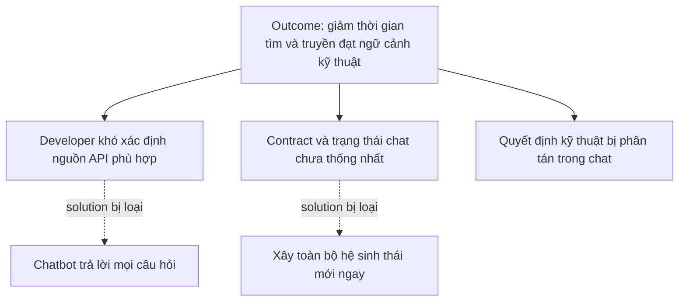
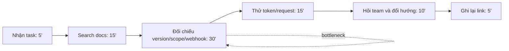
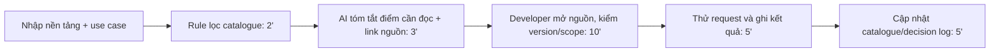

# Báo cáo nhóm — Day 02 Discovery & Problem Framing

> Case study cá nhân mô phỏng một team xây hệ sinh thái chat nội bộ, với các góc nhìn team lead, backend, mobile và fullstack do Bảo Hoàng Thiên Phúc tổng hợp. Các số liệu là ước lượng dùng cho pilot; cần thay bằng dữ liệu thật nếu có.

## 1. Thông tin nhóm

- Tên nhóm: NhomCuaCat
- Thành viên: xem `TEAM.md`
- Candidate problem được chọn: Developer mất nhiều thời gian tìm và đối chiếu tài liệu API Meta, Zalo và TikTok khi build hệ sinh thái chat nội bộ.
- Quyết định cuối: **Go — pilot nhỏ, có người kiểm tra**

---

## 2. Hội tụ nhóm (CP3)

### 2.1. Pitch

| # | Người đưa ra | Candidate | Actor | Bottleneck | Câu hỏi phản biện nhận được |
|---:|---|---|---|---|---|
| 1 | Thiên Phúc | Tìm tài liệu API bên thứ ba | Fullstack/backend | Đối chiếu version, scope, webhook | Catalogue + checklist đã đủ chưa? |
| 2 | Team lead | Theo dõi quyết định kỹ thuật | Cả nhóm | Tìm lại thread và bối cảnh | Ai chịu trách nhiệm cập nhật decision log? |
| 3 | Backend dev | Handoff API contract | Backend/mobile | Hỏi lại field và trạng thái | Có đo được số vòng sửa payload không? |
| 4 | Mobile dev | Đồng bộ trạng thái tin nhắn | Mobile/backend | Chưa thống nhất event state | Pain nằm ở tài liệu hay ở quy ước? |

### 2.2. Cluster

| Cluster | Các candidate | Pattern chung |
|---|---|---|
| A — Tài liệu API | Tìm Meta, Zalo, TikTok; kiểm OAuth/webhook | Nhiều nguồn, version và quyền khó đối chiếu |
| B — Giao tiếp kỹ thuật | Handoff contract; đồng bộ event state | Ngữ cảnh và quy ước bị phân tán trong chat |
| C — Quyết định | Tìm lại kiến trúc và lý do chọn | Khó truy xuất quyết định cũ |

### 2.3. Opportunity Solution Tree rút gọn

Những ý đã gạch bỏ vì là solution đội lốt opportunity: “xây agent đọc mọi tài liệu”, “chatbot tự quyết endpoint”, “tự động hóa toàn bộ giao tiếp”.

### 2.4. Chấm điểm shortlist (1–5)

| Candidate | Actor rõ | Quy trình rõ | Pain có bằng chứng | Impact đo được | Vừa sức lab | So sánh được 4 mức | Nhóm hiểu domain | Tổng |
|---|---:|---:|---:|---:|---:|---:|---:|---:|
| Tìm và đối chiếu tài liệu API | 5 | 5 | 4 | 5 | 5 | 5 | 5 | **34** |
| Handoff API contract | 5 | 4 | 4 | 4 | 5 | 4 | 4 | **30** |
| Tìm quyết định kỹ thuật | 4 | 3 | 3 | 4 | 3 | 4 | 4 | **25** |

**Candidate được chọn:** Tìm và đối chiếu tài liệu API Meta, Zalo và TikTok.

**Vì sao chọn:** Actor rõ, pain xảy ra trực tiếp trong integration, có thể đo thời gian và có baseline No AI/Rule rõ ràng.

**Vì sao loại các candidate còn lại:** Handoff API contract là hướng tiếp theo vì cần thêm dữ liệu về số lỗi payload. Tìm quyết định kỹ thuật có impact rộng nhưng phụ thuộc quyền truy cập lịch sử chat và dễ mở rộng quá phạm vi lab.

**Xử lý bất đồng:** Một thành viên muốn chọn chatbot nội bộ ngay. Nhóm thống nhất quay lại Job Story và chọn problem trước; chatbot chỉ là một giả thuyết giải pháp.

---

## 3. Kiểm chứng + research giải pháp đã có (CP4)

### 3.1. Assumption Map

| # | Giả định | Loại | Quan trọng | Đã có bằng chứng | Kiểm chứng trước? |
|---:|---|---|---:|---:|---|
| 1 | Developer mất trên 45 phút để xác định tài liệu API phù hợp | Value | 5 | 2 | ✅ |
| 2 | Bottleneck nằm ở đối chiếu scope/version, không chỉ ở search | Value | 5 | 2 | ✅ |
| 3 | Catalogue nguồn chính thức giảm được câu hỏi lặp lại | Usability | 4 | 2 | ✅ |
| 4 | Nguồn tài liệu có thể phân loại theo nền tảng, version và use case | Feasibility | 4 | 3 | ✅ |
| 5 | Dữ liệu cấu hình/credential không bị đưa vào công cụ AI | Viability | 5 | 1 | ✅ |

**Giả định nhóm kiểm chứng:** thời gian thực tế, bước đau nhất và mức độ đủ dùng của catalogue/checklist.

### 3.2. Kiểm chứng

Cách đã dùng: phỏng vấn nhanh 3 developer/PO có kinh nghiệm integration và rà lại các task gần đây. Không ghi tên thật.

| Vai trò người được hỏi | Tín hiệu chính | Workaround | Mất bao lâu |
|---|---|---|---:|
| Backend developer | Đã từng dùng ví dụ cũ vì không biết version nào áp dụng | Lưu link trong bookmark cá nhân | 45–60 phút/task |
| Mobile developer | Cần contract và trạng thái rõ hơn là chatbot | Hỏi backend trong chat rồi tự ghi chú | 30–40 phút/feature |
| Fullstack developer | Search được trang API nhưng vẫn mất thời gian kiểm scope/webhook | Mở nhiều tab và thử request | 60–90 phút/task |

**Tín hiệu phản bác:** một người nói với API quen thuộc, checklist và link chính thức đã đủ; không muốn đưa dữ liệu cấu hình vào AI.

**Nhóm đã sửa problem thế nào sau kiểm chứng:** thu hẹp từ “xây hệ sinh thái chat thông minh” thành “giảm thời gian xác định tài liệu API áp dụng cho task”; AI chỉ là một bước hỗ trợ sau catalogue.

### 3.3. Research giải pháp đã có

| Công cụ / case / pattern | Link | Giải bước nào? | Điểm mạnh | Khoảng trống / rủi ro | Bài học |
|---|---|---|---|---|---|
| Meta for Developers | https://developers.facebook.com/docs/ | Cung cấp nguồn chính thức cho API, OAuth, webhook | Có tài liệu theo sản phẩm | Nhiều version và quyền, cần lọc theo use case | Catalogue phải giữ link và version |
| Zalo Developers | https://developers.zalo.me/ | Cung cấp tài liệu API và ứng dụng | Có nguồn chính thức | Người mới khó biết luồng nào phù hợp | Cần ghi use case và ví dụ đã chạy |
| TikTok for Developers | https://developers.tiktok.com/ | Cung cấp tài liệu sản phẩm, OAuth và API | Có phân chia sản phẩm | Nhiều điều kiện quyền truy cập | Không để AI đoán scope; phải link nguồn |

**Kết luận research:** Nhóm không nên tự xây kho tài liệu từ đầu. Pilot nên dùng catalogue Markdown/Sheet có nguồn chính thức, sau đó thử Workflow tóm tắt có trích link. Nếu catalogue và checklist đã đủ, giữ phương án No AI/Rule.

---

## 4. Quy trình trước/sau (CP5)

### 4.1. Quy trình hiện tại

| Bước | Actor | Input | Output | Thời gian / tần suất | Ghi chú |
|---:|---|---|---|---|---|
| 1 | Lead/developer | Task integration | Use case | 5 phút/task | Có thể thiếu version |
| 2 | Developer | Từ khóa | Danh sách link | 15 phút/task | Nhiều kết quả |
| 3 | Developer | Các link | Link phù hợp | 30 phút/task | Bottleneck chính |
| 4 | Developer | Token, request | Kết quả thử | 15 phút/task | Có thể gặp 401/403 |
| 5 | Developer/team | Lỗi hoặc điểm chưa rõ | Hướng xử lý | 10 phút/task | Handoff qua chat |
| 6 | Developer | Link đã dùng | Ghi chú cá nhân | 5 phút/task | Khó chia sẻ lại |

**Bottleneck chính:** Đối chiếu version, scope, webhook và điều kiện dùng của tài liệu.

### 4.2. Quy trình tương lai

- **Rule:** lọc catalogue theo nền tảng, version, use case và tag quyền.
- **AI:** chỉ tóm tắt phần liên quan và trích link nguồn trong catalogue.
- **Con người:** mở nguồn chính thức, kiểm tra scope/version, chạy request và quyết định dùng hay không.
- **Boundary:** AI không tự khẳng định tài liệu đúng, không đọc credential, không tự sửa code production và không tự gửi thông báo.
- **Phương án quay về:** nếu AI tóm tắt sai hoặc không tìm thấy nguồn, dùng catalogue + checklist thủ công.

### 4.3. Before / after

| Chỉ số | Trước | Sau (kỳ vọng) | Ghi chú |
|---|---:|---:|---|
| Số bước | 6 | 6 | Một số bước được chuẩn hóa |
| Tổng thời gian | 60–90 phút | dưới 25 phút | Đo trong pilot 2 tuần |
| Số bước thủ công | 6/6 | 3/6 | Developer vẫn kiểm nguồn và test |
| Bottleneck chính | Đối chiếu tài liệu | Kiểm nguồn và scope | Đây là HITL bắt buộc |
| Rủi ro mới | Dùng nhầm nguồn | Tóm tắt sai hoặc bỏ sót | Xử lý bằng link nguồn + review |

---

## 5. Problem Statement v0 (CP5)

| Trường | Nội dung |
|---|---|
| Actor | Fullstack/backend developer phụ trách integration |
| Quy trình | Nhận task → search tài liệu → đối chiếu version/scope/webhook → thử request → hỏi team → ghi link |
| Bottleneck | Đối chiếu nhiều trang và xác định tài liệu phù hợp, khoảng 30–45 phút |
| Impact | Task integration chậm, tăng câu hỏi lặp lại và có nguy cơ dùng sai endpoint/scope |
| Success Metric | Baseline 60 phút/task → target dưới 25 phút/task; đo bằng bấm giờ trong 2 tuần và đếm số câu hỏi lại |
| Boundary | Developer luôn kiểm tra nguồn chính thức; không đưa credential vào công cụ; không tự sửa code production |

**Phản biện nhận được:** Metric chỉ đo thời gian, chưa đo độ chính xác của nguồn. Nhóm đồng ý và thêm tiêu chí link nguồn, scope và số lần sửa ở v1.

---

## 6. Mức can thiệp AI (CP6)

### 6.1. Ma trận độ mơ hồ × độ phức tạp

Bài nằm ở ô **độ mơ hồ cao, độ phức tạp thấp–trung bình**: có nhiều cách tóm tắt tài liệu được chấp nhận nhưng quy trình đầu vào, kiểm tra nguồn và test request khá cố định.

### 6.2. So sánh 4 mức

| Mức | Phương án | Đủ khi nào | Rủi ro | Chọn? |
|---|---|---|---|---|
| No AI | Catalogue + checklist + decision log | API quen thuộc, nguồn ít thay đổi | Vẫn mất thời gian đọc | Dùng làm baseline |
| Rule | Lọc catalogue theo tag/version/scope | Metadata đủ chuẩn | Catalogue cập nhật chậm | Dùng cho bước lọc |
| Workflow | Rule lọc → AI tóm tắt → dev kiểm nguồn → test | Các bước cố định, AI chỉ hỗ trợ đọc | Tóm tắt sai/thiếu | **Chọn** |
| Agent | AI tự tìm, tự chọn nguồn, tự thử và tự trả lời | Chỉ khi có quyền và eval rất chắc | Chọn nhầm nguồn, khó truy vết | Không chọn |

**Mức chọn:** Workflow.

**Vì sao không chọn mức đơn giản hơn:** No AI/Rule xử lý tốt phần lưu trữ và lọc, nhưng chưa giảm thời gian đọc/tổng hợp nhiều trang. Tuy nhiên nhóm vẫn giữ chúng làm nền và fallback, không nhảy thẳng lên Agent.

### 6.3. AI Canvas rút gọn

| Thành phần | Nội dung |
|---|---|
| Prediction | Tóm tắt phần tài liệu liên quan và gợi ý các mục cần kiểm tra |
| Judgment | Developer quyết định nguồn, scope, version và cách triển khai |
| Action | Developer mở link, thử request và cập nhật catalogue |
| Outcome | Thời gian/task, số câu hỏi lại, số lỗi do dùng sai nguồn |
| Input | Nền tảng, use case, version, môi trường và catalogue nguồn chính thức |
| Feedback | Link bị loại, phần tóm tắt bị sửa và kết quả test request |

### 6.4. Hai câu hỏi của Google PAIR

- Người dùng muốn **được hỗ trợ (augment)**. Bằng chứng: developer vẫn muốn tự mở tài liệu, xem ví dụ đầy đủ và chịu trách nhiệm kiểm tra; họ chỉ muốn giảm thời gian tìm và tổng hợp.
- **Bỏ sót scope hoặc điều kiện quan trọng** tệ hơn báo nhầm, vì có thể dẫn tới code sai hoặc lỗi quyền. Thiết kế xử lý bằng link nguồn bắt buộc, checklist scope/version và HITL trước khi code.

---

## 7. Problem Statement v1 + tiêu chí đánh giá

| Trường | Nội dung |
|---|---|
| Actor | Fullstack/backend developer làm integration API cho hệ sinh thái chat |
| Quy trình | Nhập use case → Rule lọc catalogue → AI tóm tắt/link → developer kiểm nguồn → thử request → cập nhật log |
| Bottleneck | Đọc và đối chiếu version/scope/webhook, khoảng 30–45 phút |
| Impact | Chậm task, hỏi lại nhiều và có nguy cơ dùng sai nguồn |
| Success Metric | 60 → dưới 25 phút/task; câu hỏi lặp lại giảm từ 4 xuống tối đa 1; không có lỗi dùng sai scope trong pilot |
| Boundary | Không đọc credential; không tự chọn nguồn ngoài catalogue; không tự sửa code hoặc gửi thông báo; developer phải kiểm tra |
| AI intervention point | Sau bước Rule lọc catalogue, trước khi developer đọc chi tiết |
| Mức chọn | Workflow |
| Rủi ro & người kiểm tra | Tóm tắt sai/bỏ sót → developer kiểm link, version, scope và request |

**Thay đổi so với v0 và lý do:** v1 thu hẹp actor vào developer làm integration, thêm AI intervention point và metric chất lượng vì phản biện cho thấy “nhanh hơn” chưa đủ.

| # | Tiêu chí | Đạt khi | Không đạt khi |
|---:|---|---|---|
| 1 | Có nguồn truy xuất | Mỗi kết luận có link tài liệu chính thức | Có nhận định không có nguồn |
| 2 | Đúng version/scope | Tóm tắt khớp version, scope và use case | Gộp nhầm version hoặc quyền |
| 3 | Không bịa | Chỉ nói trong phạm vi catalogue/input | Thêm endpoint hoặc giới hạn không có trong nguồn |
| 4 | Hữu ích | Developer xác định được trang cần đọc trong dưới 5 phút | Vẫn phải search lại từ đầu |

---

## 8. Quyết định (CP6)

| Rủi ro | Mức độ | Lý do / bằng chứng |
|---|---|---|
| Value | Trung bình | Pain xuất hiện nhiều lần nhưng cần đo thêm trên task thật |
| Usability | Thấp | Workflow chỉ thêm bước tóm tắt; developer vẫn dùng quy trình quen thuộc |
| Feasibility | Trung bình | Catalogue làm được ngay; chất lượng AI và metadata cần thử |
| Viability | Trung bình | Phải giữ an toàn credential và kiểm tra chính sách dữ liệu |

**Quyết định:** Go, phạm vi nhỏ.

**Pilot nhỏ nhất:** Trong 2 tuần, chọn 6 task integration. Tạo catalogue 15–20 link chính thức, dùng prompt/workflow cố định, bấm giờ, ghi phần tóm tắt bị sửa và số câu hỏi lại.

**Ngưỡng dừng:** Nếu sau 6 task thời gian không giảm ít nhất 30%, hoặc có một lần tóm tắt làm nhóm dùng sai scope mà không phát hiện trước khi code, dừng AI và quay về catalogue + checklist thủ công.

---

## 9. Hạn chế và hướng tiếp theo

- Các số liệu hiện là ước lượng, cần thay bằng log hoặc bấm giờ thật.
- Bài được thực hiện một mình theo thông tin người học cung cấp; nếu LMS bắt buộc nhóm 3–4 người, cần xác nhận lại với giảng viên trước khi nộp.
- Cần kiểm tra chính sách dữ liệu trước khi đưa tài liệu nội bộ vào bất kỳ công cụ AI nào.
- Hướng tiếp theo là thử handoff API contract sau khi pilot tài liệu API có kết quả.

## 10. Tài liệu tham khảo

- [Meta for Developers](https://developers.facebook.com/docs/)
- [Zalo Developers](https://developers.zalo.me/)
- [TikTok for Developers](https://developers.tiktok.com/)
- [Anthropic — Building Effective Agents](https://www.anthropic.com/research/building-effective-agents)
